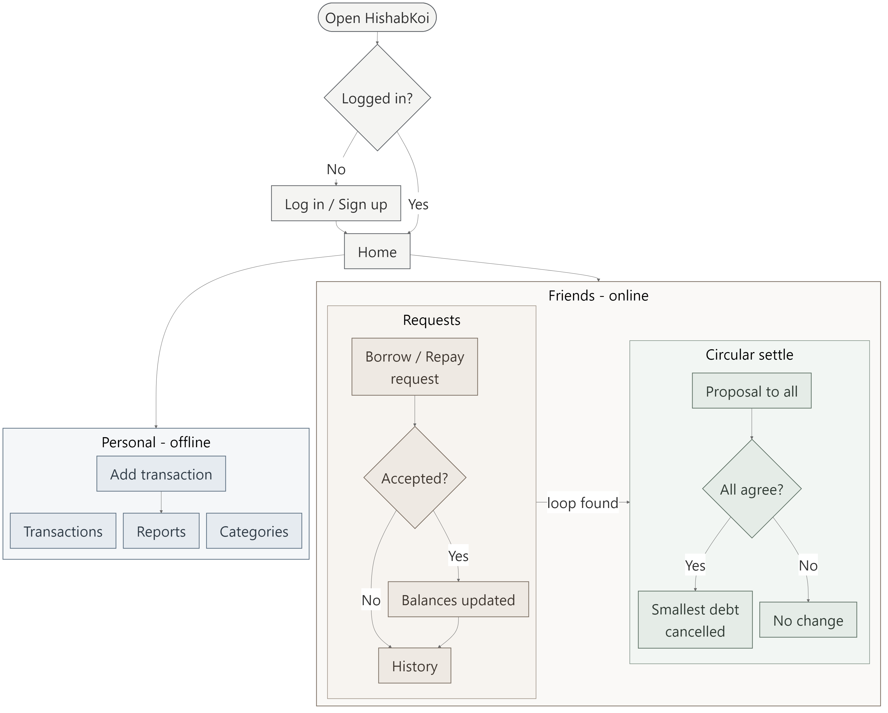
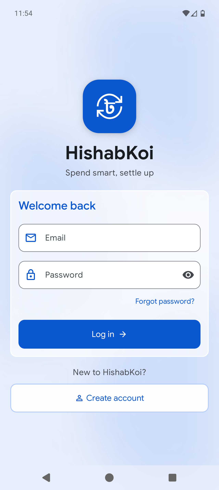
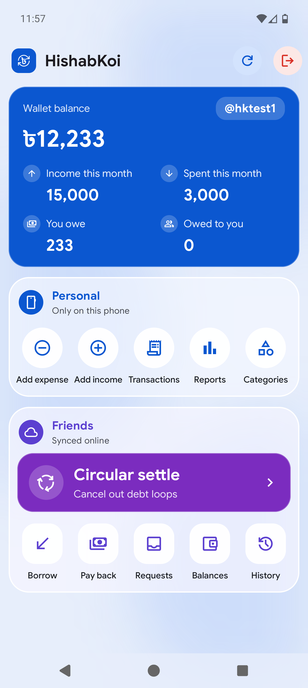
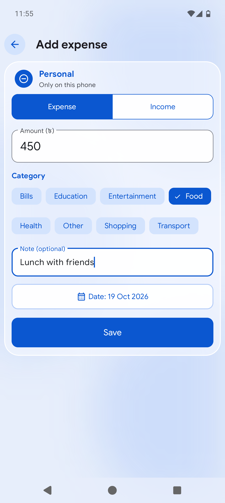
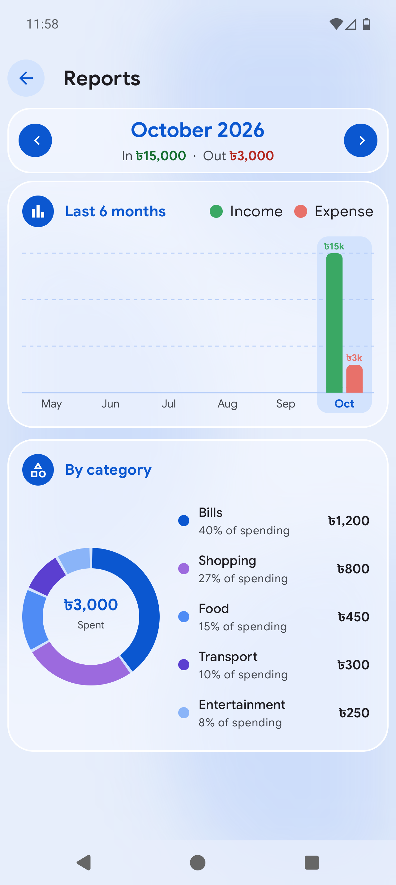
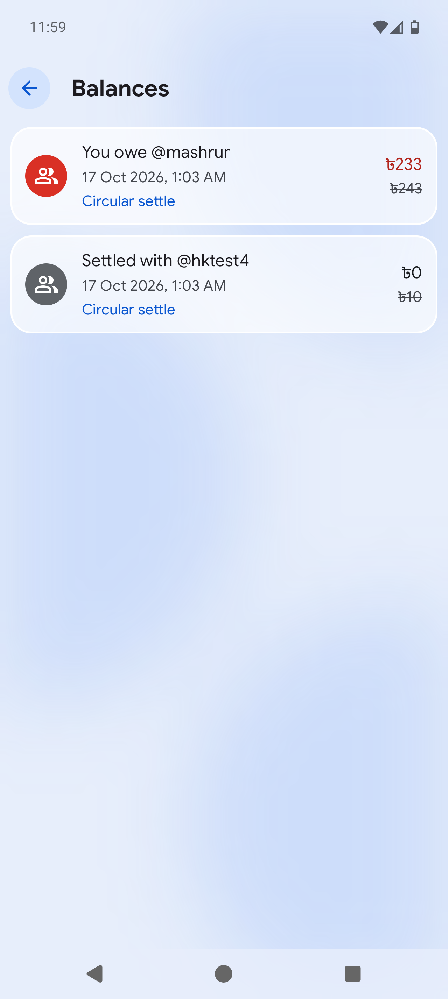
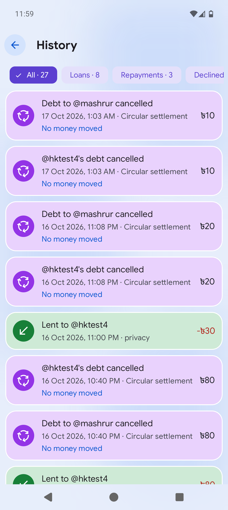

  

<h1 align="center">HishabKoi</h1>

HishabKoi is an Android app (Java) for tracking your own money and the money you lend to or borrow from friends.

## How it works

The home screen shows your wallet balance, this month's income and spending, and how much you owe or are owed. Everything else falls into two sections.

**Personal: only on this phone.** Expenses and income are stored locally with Room and never leave the device.
- Add an expense or income entry with an amount, category, note and date.
- Browse your transactions, or open Reports for a 6-month income/expense bar chart and a donut chart of spending by category.
- Add or delete categories.

**Friends: synced online.** Loans go through Firebase Auth and Firestore. Each account has an email and a unique `@username`.
- **Borrow / Pay back**: send a request to a friend's `@username`. Nothing changes until they accept it. Once they do, both wallets and balances update.
- **Requests**: accept or decline incoming requests, or cancel your own.
- **Balances**: shows who owes whom. When a debt was reduced by a circular settlement, the old amount is shown crossed out.
- **History**: every loan, repayment, decline and settlement, with filters.
- **Circular settle**: the app looks for debt loops (A owes B, B owes C, C owes A) of 3 to 8 people. It proposes a settlement to everyone in the loop. If all of them approve, the smallest debt in the loop is subtracted from every debt along it, so the loop shrinks and no money changes hands.

Firestore security rules (`firestore.rules`) only allow valid balance changes. Each user can approve only for themselves, and every settlement has to match a real loop. The rule tests are in `firestore-tests/`.

## Flowchart

  

## Screenshots

| Login | Home | Add expense |
|:---:|:---:|:---:|
|  |  |  |
| **Reports** | **Balances** | **History** |
|  |  |  |

## Building

Open the project in Android Studio and run the `app` module. It needs Android 14 (API 34) or newer. The app connects to Firebase using `app/google-services.json`.
